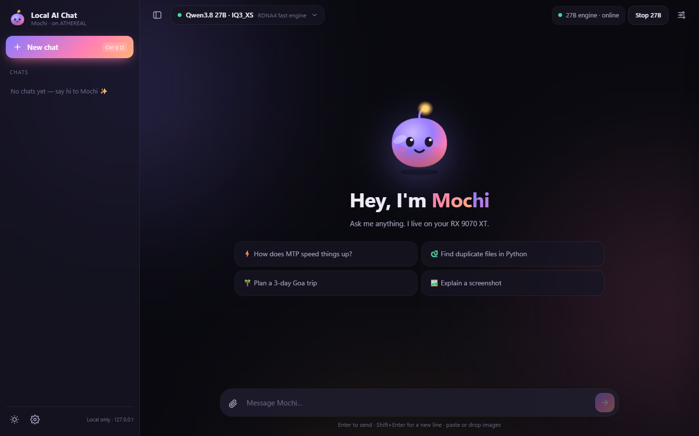
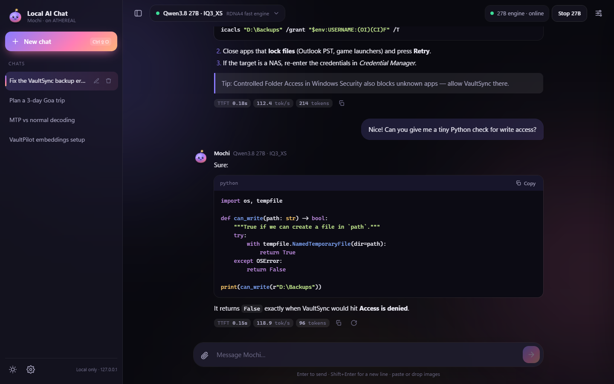
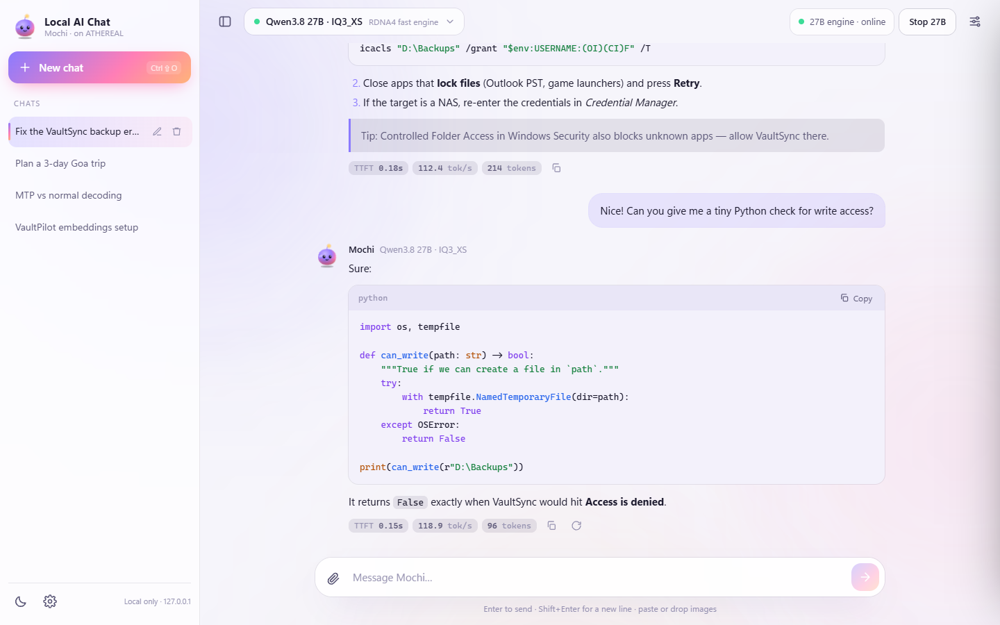
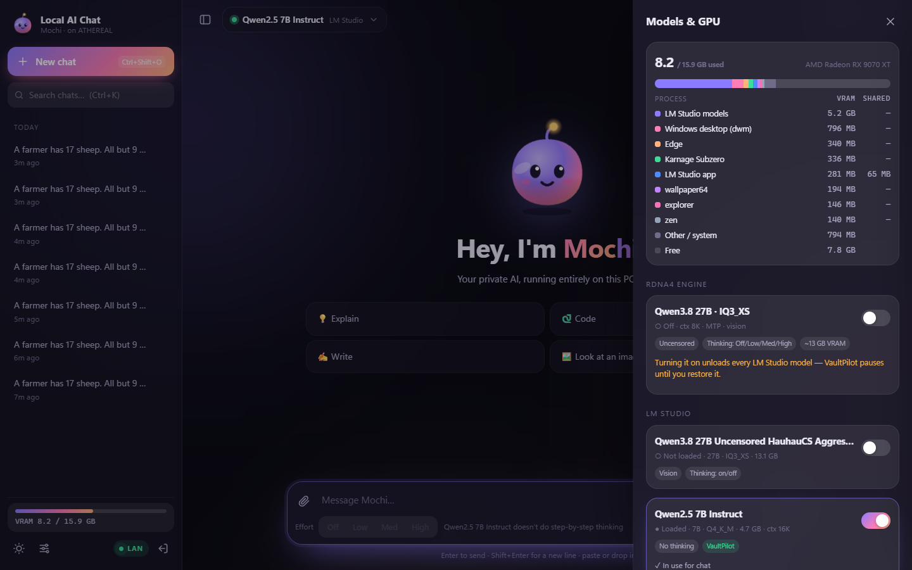

<div align="center">


# Mochi — Local AI Chat UI

**A fast, zero-dependency, private web UI for local LLMs, VLMs, and tool-using agents.**

Built with pure Python (stdlib only) + vanilla HTML/CSS/JS — no Node build step, no external CDNs, no telemetry.

[](LICENSE)


</div>

---

## Highlights

- **Zero-dependency core:** Runs directly on the Python standard library and plain ES6/CSS3 — zero `npm install`, zero `pip install` needed for the server itself.
- **Dual-backend support:** Proxies OpenAI-compatible SSE streams from both a custom local inference engine (`127.0.0.1:8080`) and **LM Studio** (`127.0.0.1:1234`), with one-click model loading/unloading and live Windows GPU VRAM breakdown.
- **17 built-in agentic tools:** Private SearXNG web search, SSRF-guarded URL fetching, weather, Wikipedia, currency conversion, persistent per-account memory, chat search, file sandbox, math/units, and a **sandboxed Python runner** (`numpy`, `pandas`, `matplotlib`, `sympy`) with inline chart rendering and mandatory confirmation.
- **Expressive companion UI:** Animated SVG Mochi avatar that reacts to thinking, talking, finishing, and errors, with dark/light/system themes, custom accent colors, density/width controls, and mobile PWA support.
- **Multi-user & remote access:** PBKDF2-SHA256 authentication with `Master`, `User`, and `Limited User` tiers, QR-code LAN mode, and optional **Tailscale Funnel** / **Cloudflare Quick Tunnel** HTTPS sharing.
- **Clean full shutdown:** One-click **Shut down Mochi** button (and `Stop-ChatUI.ps1 -All`) that stops the server, tears down tunnels, stops SearXNG, restores temporary LAN changes, and optionally unloads all loaded GPU models.

---

## Screenshots

<table>
  <tr>
    <td align="center"><br/><sub><b>Home &amp; Mochi Avatar</b></sub></td>
    <td align="center"><br/><sub><b>Streaming Chat &amp; Code Highlighting (Dark)</b></sub></td>
  </tr>
  <tr>
    <td align="center"><br/><sub><b>Light Theme</b></sub></td>
    <td align="center"><br/><sub><b>Models &amp; Live GPU VRAM Breakdown</b></sub></td>
  </tr>
</table>

---

## Built-in Tool System

Mochi uses a single server-side registry ([`mochi_tools.py`](mochi_tools.py)) exposed via `GET /api/tools` and `POST /api/tools/execute`, with risk-tiered execution rules:

| Category | Tools | Risk Policy | Access |
|---|---|---|---|
| **Basics** | `get_current_datetime`, `calculate` (AST math), `unit_convert` | `safe` — runs automatically | Master, User |
| **Memory &amp; PC** | `remember`, `recall`, `forget`, `search_chats`, `system_status` | `safe` — runs automatically (`remember` injects into system prompt) | Master, User (`system_status`: Master) |
| **Files** | `list_files`, `read_file`, `write_file` | `files` — sandboxed to `data/users/<id>/files` | Master, User |
| **Web** | `web_search` (private SearXNG), `fetch_url` (SSRF-guarded), `get_weather`, `wikipedia`, `currency_convert` | `network` — respects *Auto-run web &amp; file tools* toggle | Master, User |
| **Code** | `run_python` (`numpy`, `pandas`, `matplotlib`, `sympy`, inline PNG charts) | `host` — **always asks for confirmation** with code preview | Master only |

> **Limited User** accounts have all tools stripped both in the UI and in the backend proxy.

### Tool Loop & Safety Features
- **Always finishes with an answer:** If a turn hits `Max tool rounds` right after receiving tool results, Mochi runs one final pass without tools so it summarizes what it found.
- **Per-tool toggles:** Enable or disable individual tools in **Settings › Chat** to save context tokens on smaller context models.
- **Python sandbox ([`mochi_sandbox.py`](mochi_sandbox.py)):** Executes with `python -I -B`, a Python `sys.addaudithook` blocking filesystem access outside the user's `files` folder, network sockets, child processes, DLL loading, and registry writes, plus a Windows Job Object enforcing a single-process, 2 GB RAM, 30-second limit.
- **SSRF guard on `fetch_url`:** Resolves DNS first, pins the IP, and blocks loopback, RFC1918 private, link-local, and multicast addresses on every redirect.

---

## Quick Start (Windows)

### 1. Prerequisites
- **Python 3.11+** (tested on Python 3.13)
- An OpenAI-compatible local backend:
  - **LM Studio** running its local server on `http://127.0.0.1:1234`, and/or
  - An OpenAI-compatible inference server on `http://127.0.0.1:8080`
- *(Optional)* **SearXNG** in `C:\Dev\Tools\searxng` (or `MOCHI_SEARXNG`) for private `web_search`
- *(Optional)* **Tailscale** or **cloudflared** for remote HTTPS access

### 2. Launch & Stop
```powershell
# Start Mochi in the background and open http://127.0.0.1:8765/
.\Start-ChatUI.ps1

# Optional flags:
.\Start-ChatUI.ps1 -Lan -NoBrowser -Port 8765

# Stop Mochi, its internet link, and SearXNG:
.\Stop-ChatUI.ps1

# Stop everything AND unload all loaded models / engine:
.\Stop-ChatUI.ps1 -All
```

Or run the server directly:
```powershell
python server.py --port 8765 --engine 127.0.0.1:8080 --lmstudio 127.0.0.1:1234
```

You can also click the **Shut down** power button in Mochi's sidebar footer (or **Settings › Account**) to cleanly stop the server, SearXNG, active tunnels, restore temporary LAN state, and unload GPU models from the UI.

---

## Architecture & Repository Layout

```text
chat-ui/
├── server.py                    # Stdlib HTTP/SSE server, auth, proxy, VRAM monitor, tunnels, shutdown
├── mochi_tools.py               # @tool registry, schemas, SearXNG lifecycle, web/file/memory tools
├── mochi_sandbox.py             # Isolated audit-hooked runner for run_python
├── Start-ChatUI.ps1             # Background launcher
├── Stop-ChatUI.ps1              # Clean stop script (-All unloads models too)
├── Add-ChatUIFirewallRule.ps1   # Optional Private-network inbound rule for LAN access
├── Remove-ChatUIFirewallRule.ps1
├── static/
│   ├── index.html               # App shell & modals
│   ├── app.js                   # SPA state, SSE streaming, tool loop, markdown/syntax highlighter
│   ├── app.css                  # Themes, responsive mobile layout, animations
│   ├── qr.js                    # Self-contained QR code SVG generator
│   ├── favicon.svg / icon-256.png / manifest.webmanifest
├── tools/
│   ├── ui_test.py               # Headless Chromium (CDP) end-to-end test suite
│   ├── ui_audit.py              # Panel layout & responsive visual audit
│   └── make_icon.py             # Generates mochi.ico & icon-256.png from mochi.png
└── docs/screenshots/            # README showcase screenshots
```

> Runtime state (`data/`, `logs/`, `*.pid`) is created locally and excluded via [`.gitignore`](.gitignore).

---

## Security & Remote Access Model

- **Authentication:** Passwords are stored as salted PBKDF2-SHA256 hashes (390,000 iterations). Sessions use `HttpOnly`, `SameSite=Strict` cookies (`Secure` over HTTPS tunnels).
- **Brute-force protection:** Login attempts are rate-limited per IP, per username, and globally for remote connections.
- **CSRF & Host validation:** Write endpoints require the `X-Local-Chat: 1` header, matching `Origin`, and validated `Host` headers.
- **LAN & Internet modes:** LAN mode binds `0.0.0.0` (accepting private RFC1918 clients only) and disables localhost skip-login for remote clients. Internet links via **Tailscale Funnel** or **Cloudflare Quick Tunnel** can only be toggled from the local PC and are torn down automatically when Mochi stops.

---

## Keyboard Shortcuts

| Shortcut | Action | Shortcut | Action |
|---|---|---|---|
| `Ctrl+Shift+O` | New chat | `Ctrl+M` | Models &amp; GPU panel |
| `Ctrl+K` | Search chats | `Ctrl+,` | Settings |
| `Ctrl+B` | Toggle sidebar | `Ctrl+Shift+L` | Toggle dark / light theme |
| `Alt+1` … `Alt+4` | Effort (Off / Low / Med / High) | `Ctrl+Shift+R` | Regenerate last reply |
| `/` | Focus message box | `Esc` | Stop generating / close modal |

---

## Environment Variables

| Variable | Purpose | Default |
|---|---|---|
| `MOCHI_SEARXNG` | Path to local SearXNG folder (`venv` + `run_searxng.py`) | `C:\Dev\Tools\searxng` |
| `MOCHI_SEARXNG_PORT` | Localhost port for SearXNG | `8888` |
| `MOCHI_PYTHON_SITE` | Optional `site-packages` exposed to `run_python` | `C:\Dev\Tools\mochi-python\Lib\site-packages` |
| `MOCHI_CLOUDFLARED` | Path to `cloudflared.exe` | `C:\Dev\Tools\cloudflared\cloudflared.exe` |
| `MOCHI_TAILSCALE` | Path to `tailscale.exe` | `C:\Program Files\Tailscale\tailscale.exe` |

---

## License

Released under the [MIT License](LICENSE).
